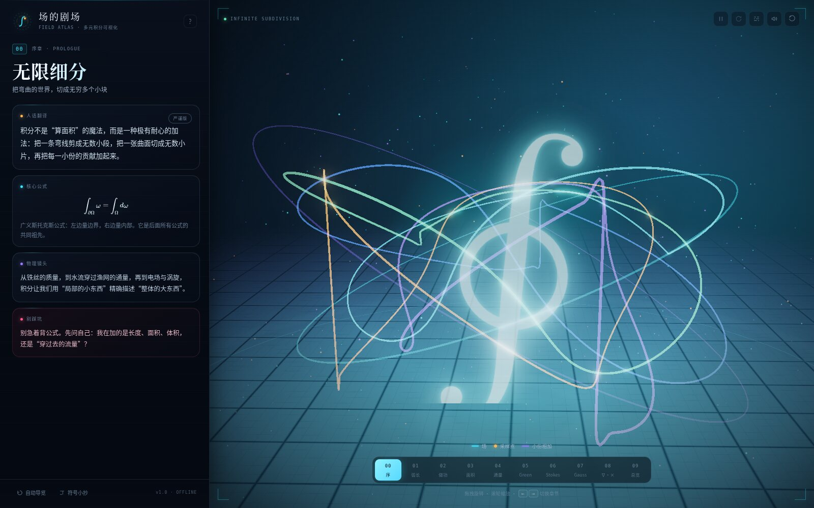
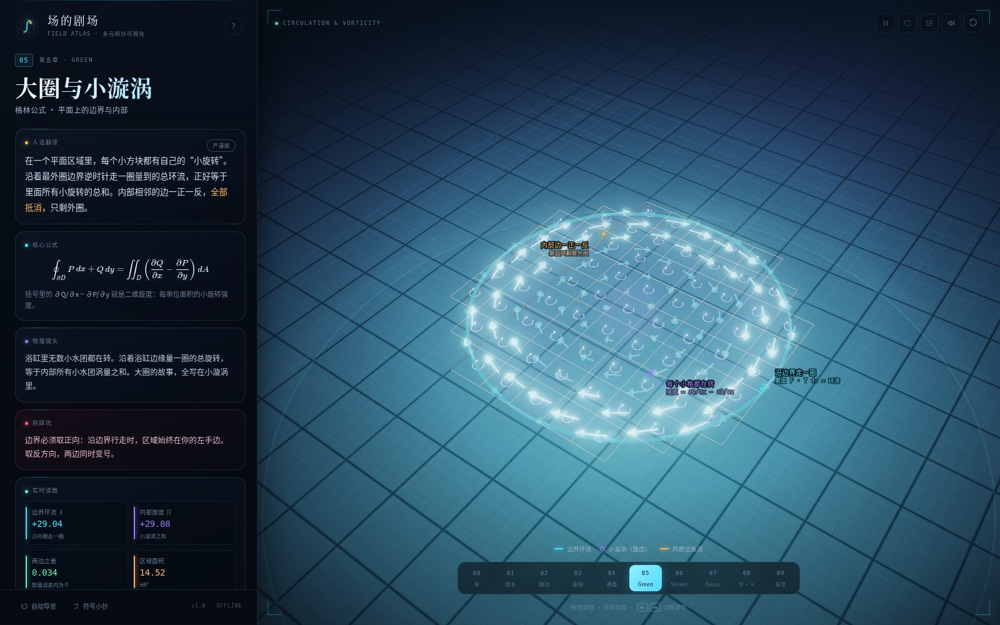
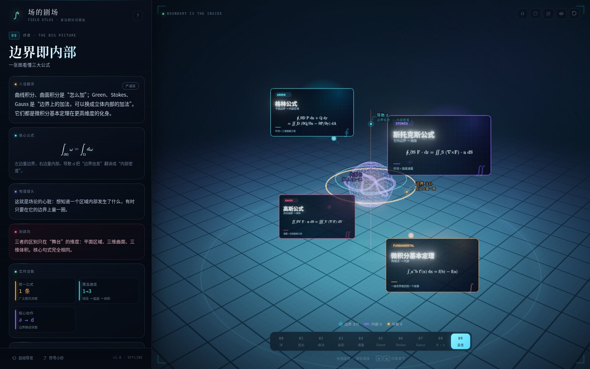
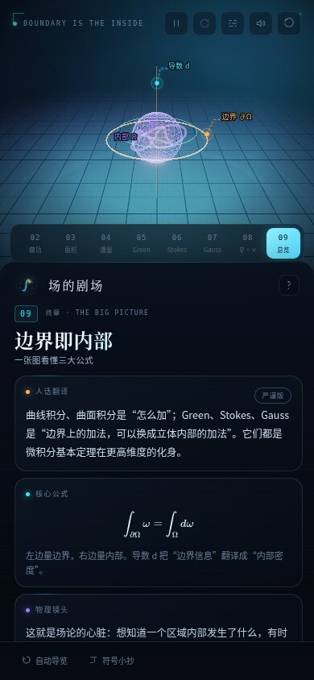

# 场的剧场 · 多元积分互动实验室

<div align="center">

**把边界、内部、旋度与通量，变成可以旋转、拨动、看见的东西。**

一个完全离线、可打包为单个 HTML 文件的中文 3D 多元积分可视化实验室。

[在线体验](https://pigjerry827.github.io/Line-integrals-Suface-integrals-Nabla-operator/) ·
[下载单文件 HTML](https://github.com/pigjerry827/Line-integrals-Suface-integrals-Nabla-operator/releases/latest) ·
[快速开始](#快速开始)

[](LICENSE)
[](https://threejs.org/)
[](#构建)
[](https://pigjerry827.github.io/Line-integrals-Suface-integrals-Nabla-operator/)

</div>



## 简介

**场的剧场**是一座可以走进去的多元积分博物馆。它把曲线积分、曲面积分、Green 公式、Stokes 公式、Gauss 公式，以及梯度、散度、旋度，做成 10 个可以旋转、缩放、点击和拨动的 3D 场景。

每个章节都由四层内容组成：

- **舞台**：可交互的 Three.js 几何、向量场与动画。
- **直觉**：先用中文解释“这个东西在现实里像什么”。
- **公式**：KaTeX 排版的严谨定义与核心公式。
- **读数**：参数变化时实时更新的数值，用来对照公式两边。

整个应用不依赖后端，也没有外部图片、字体或音频请求。执行一次构建后，会得到一个约 2.6 MB 的独立 HTML 文件，双击即可在支持 WebGL 的现代浏览器中打开。

## 章节

| 编号 | 章节 | 主题 |
| --- | --- | --- |
| 00 | 无限细分 | 积分作为极限加法；广义 Stokes 公式 |
| 01 | 一根弯铁丝的重量 | 第一类曲线积分 · 对弧长 |
| 02 | 推箱子走弯路 | 第二类曲线积分 · 做功与环流 |
| 03 | 给曲面刷一层漆 | 第一类曲面积分 · 对面积 |
| 04 | 数一数穿过渔网的水 | 第二类曲面积分 · 通量 |
| 05 | 大圈与小漩涡 | Green 公式 · 边界与平面内部 |
| 06 | 曲面的边缘 | Stokes 公式 · 空间边界与旋度 |
| 07 | 袋子里的水龙头 | Gauss 公式 · 闭合曲面与散度 |
| 08 | 三把手术刀 | 梯度、散度、旋度实验台 |
| 09 | 边界即内部 | 四大公式的统一图景 |

| Green 公式 | 总结 |
| --- | --- |
|  |  |

<p align="center">
  
  <br />
  <sub>移动端采用上下分栏，章节、讲解与舞台仍然完整可用。</sub>
</p>

## 功能

- **10 个完整章节**，覆盖四类积分、三大公式和三个微分算子。
- **可交互 3D 舞台**：拖拽旋转、滚轮缩放、点击探针、切换向量场、调节区域半径与网格细分。
- **公式与读数联动**：修改参数后，边界积分、内部积分和误差会同步更新。
- **严格与直觉双版本**：每个章节都有“直觉翻译”和“严谨版”讲解。
- **移动端适配**：窄屏下自动切换为上下布局，并压缩标注信息。
- **程序化环境音**：使用 Web Audio 实时生成氛围铺底与铃音，不包含任何采样文件。
- **完全离线**：字体、公式、脚本、图标全部内联，不发起外部网络请求。
- **可访问性细节**：键盘操作、焦点管理、ARIA 状态、减少动态效果偏好。

## 快速开始

环境要求：Node.js 20+，npm 10+。

```bash
git clone https://github.com/pigjerry827/Line-integrals-Suface-integrals-Nabla-operator.git
cd Line-integrals-Suface-integrals-Nabla-operator
npm ci
npm run build
```

构建完成后打开根目录下的：

```text
多元积分_互动实验室.html
```

不需要开发服务器，直接双击即可。如果浏览器对 `file://` 有限制，也可以在当前目录启动一个静态服务器：

```bash
python3 -m http.server 8000
```

然后访问 `http://localhost:8000/多元积分_互动实验室.html`。

### 重新生成截图

```bash
npm run shot
```

该脚本会依次渲染所有章节，并输出桌面端与移动端截图到 `screenshots/`。它默认使用 Linux 下的 `/usr/bin/google-chrome`；其他系统请在 `scripts/shoot.mjs` 中修改 `executablePath`。

## 操作

| 操作 | 效果 |
| --- | --- |
| 拖拽舞台 | 旋转 3D 视角 |
| 滚轮 / 双指 | 缩放 |
| 点击舞台探针 | 移动采样点或拖动探针 |
| `←` / `→` | 上一章 / 下一章 |
| `空格` | 暂停 / 继续动画 |
| `R` | 重置视角 |
| `L` | 显示 / 隐藏标注 |
| `M` | 开启 / 关闭环境音 |

舞台右上角也提供暂停、自动旋转、标注、环境音和重置按钮。章节条与总结页的按钮可以直接跳转。

## 项目结构

```text
.
├── src/
│   ├── main.js                 # 应用启动、章节路由、快捷键与状态
│   ├── content.js              # 10 个章节的文案、公式与图例
│   ├── styles.css              # 布局、响应式、动画与组件样式
│   ├── index.template.html     # 单文件构建模板
│   ├── core/
│   │   ├── engine.js           # Three.js 渲染、相机补间、Bloom
│   │   ├── ui.js               # 面板、章节条、控件、弹窗
│   │   ├── sceneKit.js         # 箭头场、管道、粒子、材质等场景工具
│   │   ├── math.js             # 曲线 / 曲面 / 区域积分的数值计算
│   │   ├── audio.js            # Web Audio 程序化环境音
│   │   ├── annotations.js      # 3D → SVG 标注层
│   │   └── utils.js            # 颜色、格式化、缓动等小工具
│   └── scenes/                 # 10 个章节的 3D 场景
├── scripts/
│   ├── build.mjs               # esbuild 单文件构建
│   └── shoot.mjs               # Puppeteer 桌面 / 移动端截图
├── docs/                       # README 预览图
├── .github/workflows/pages.yml # GitHub Pages 自动部署
├── LICENSE
└── THIRD_PARTY_NOTICES.md
```

## 数学与实现

- 曲线、曲面和区域的积分都在 `src/core/math.js` 中通过采样求和近似。
- Green、Stokes、Gauss 章节同时计算边界量与内部量。例如默认参数下：
  - Green：环流 `+29.04`，旋度面积分 `+29.08`；
  - Stokes：两侧均为 `+29.04`；
  - Gauss：表面通量 `+85.62`，散度体积分 `+85.63`。
- 误差来自离散采样，不是公式本身；调整细分参数和区域大小可以观察收敛趋势。
- 曲面定向与边界方向遵循右手定则。`surface-vector` 章节把法向修正为向上后，净通量显示为 `+14.418`，与“净流出”的方向标签一致。
- 公式使用 KaTeX 离线渲染；字体以 data URL 内联进最终 HTML。

## 环境音

`src/core/audio.js` 使用 Web Audio API 合成一段循环氛围：

- 8 个缓慢变化的和弦铺底，带失谐、低通滤波和左右声像；
- 稀疏的 D 小调五声音阶铃音；
- 卷积混响与反馈延迟；
- 进入实验室后淡入，暂停或关闭时淡出。

浏览器要求音频在用户手势后才能启动，因此环境音会在点击“进入实验室”或首次交互后开始。开关状态保存在 `localStorage` 中，也可以用 `M` 键切换。

## 技术栈

- [Three.js](https://threejs.org/) r186：WebGL 场景、实例化箭头、参数曲面、Bloom。
- [KaTeX](https://katex.org/) 0.16：离线公式排版。
- [esbuild](https://esbuild.github.io/)：将 JS、CSS、字体打包成单文件。
- [Puppeteer](https://pptr.dev/)：桌面端与移动端视觉回归截图。
- Web Audio API：程序化环境音。
- 原生 HTML / CSS / JavaScript，无前端框架。

## 部署

仓库包含 GitHub Actions 工作流 [`.github/workflows/pages.yml`](.github/workflows/pages.yml)。推送到 `main` 后，它会：

1. 安装依赖并执行 `npm run build`；
2. 将生成的 HTML 复制为 `dist/index.html`；
3. 上传静态站点并部署到 GitHub Pages。

首次使用时，请在仓库 **Settings → Pages → Build and deployment** 中选择 **GitHub Actions**。在线版本地址：

<https://pigjerry827.github.io/Line-integrals-Suface-integrals-Nabla-operator/>

单文件版本同时会附加到 GitHub Releases，适合直接下载、离线演示或课堂分发。

## 已知限制

- 需要支持 WebGL 的现代浏览器；没有 WebGL 时会显示阅读模式提示。
- 首次进入时环境音必须等待一次用户手势，这是浏览器自动播放策略的要求。
- `npm run shot` 的 Chrome 路径是 Linux 默认值，跨平台使用时需要自行修改。
- 视觉回归截图依赖 SwiftShader，在无 GPU 的 CI 环境中速度较慢。

## 致谢

视觉与叙事受到这些优秀项目和作品启发，但代码、几何、文案与音轨均为本项目原创：

- [Three.js examples](https://threejs.org/examples/)：Bloom、实例化与参数几何的工程范例。
- [3Blue1Brown / Manim](https://www.3blue1brown.com/)：先直觉、后公式的讲解方式。
- [MathBox](https://mathbox.org/)：3D 数学视觉语言。
- [Bartosz Ciechanowski](https://ciechanow.ski/)：可操作、可探索的解释性文章。
- [Setosa](https://setosa.io/)：直接操纵式可视化。
- [KaTeX](https://katex.org/)：离线公式排版。

第三方依赖的许可证与版权声明见 [THIRD_PARTY_NOTICES.md](THIRD_PARTY_NOTICES.md)。

## English

**A Theatre of Fields** is a single-file, offline-first interactive atlas for multivariable integration. It covers line and surface integrals, Green / Stokes / Gauss theorems, and the gradient, divergence and curl operators across ten explorable 3D chapters. The UI and teaching copy are in Chinese. Built with Three.js, KaTeX, esbuild and the Web Audio API; no external assets or backend are required.

## License

本项目以 [MIT License](LICENSE) 开源。第三方依赖的许可证见 [THIRD_PARTY_NOTICES.md](THIRD_PARTY_NOTICES.md)。
